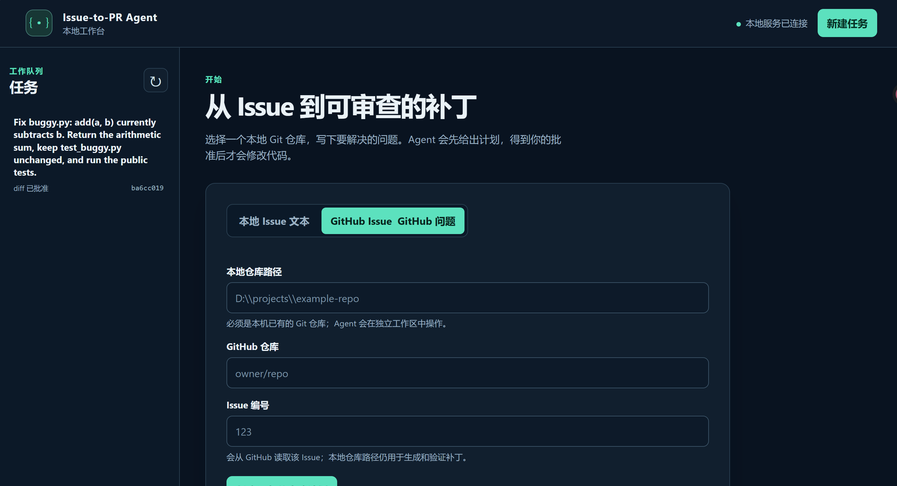

# Issue-to-PR Agent 本地界面：第一次使用指南

本指南按当前 `web/index.html`、`web/app.js` 和 `web/app.css` 的真实行为编写。



这张截图展示页面布局和 GitHub Issue 输入模式，**不是空数据库画面**，也不代表
图中的任务已完成完整发布流程。第一次使用时建议先选“本地 Issue 文本”。

这个页面把一个 Issue 变成可审查的本地补丁。你先批准计划，Agent 才会执行；你看完
补丁和公开测试结果后，再分别审批 diff 和 Draft PR 请求。默认启动到“已准备发布”为止，
不会 commit、push 或创建真实 GitHub PR；只有显式真实发布模式才会开放最后一步。
如果你只是想先熟悉页面，可以查看
已有任务；点“创建任务并生成计划”会调用模型，可能产生费用。

## 开始前准备什么

请在项目根目录启动 `python service_http.py --open`；浏览器没自动打开时，手动访问
`http://127.0.0.1:8765/`。这不是“clone 后什么都不用准备”的服务：

| 准备项 | 为什么需要 |
|---|---|
| Python 3.10 或更高、Git，以及项目依赖（在项目根目录运行 `python -m pip install -e ".[dev]"`） | Python/依赖用于服务和 Agent；Git 用于创建独立 worktree。前端不用 npm 或构建。 |
| 一个**本机已有、已提交且干净的 Git 仓库** | “本地仓库路径”不是 GitHub URL。创建任务会拒绝使 `git status --porcelain` 非空的已修改文件和非忽略的未跟踪文件；`git status --short` 应没有输出。可先提交需要保留的文件，或另用一份干净的克隆；不要为过检查盲目删除文件。 |
| 模型配置 | 点击“创建任务并生成计划”会调用模型；后续执行也会调用模型。在本机设置 `DEEPSEEK_API_KEY` 环境变量，或在项目根目录的 `.env` 中配置它；不要把密钥贴进页面、日志或 Git。启动自检只检查变量名或文件是否存在，**不会验证凭据可用**。 |
| Docker daemon 已启动（Windows 上通常是 Docker Desktop），以及 runner 镜像 | 点“开始执行”后，仓库命令和公开测试需要隔离容器。默认镜像为 `issue-to-pr-runner:phase3`；尚未构建时在项目根目录运行 `docker build -t issue-to-pr-runner:phase3 -f docker/Dockerfile .`。若设置了 `AGENT_SANDBOX_IMAGE`，需要构建相同标签。缺少 Docker 不会静默回退到宿主机执行。 |
| 真实发布专用：`GITHUB_TOKEN`、Git 用户名/邮箱及目标仓库写权限 | 仅 `--real-publisher` 的最后一步需要。token 至少要有目标仓库 Contents: write 与 Pull requests: write 权限；不要粘贴到网页、日志或提交到 Git。remote 必须指向冻结请求中的同一 `owner/repo`。 |

启动终端会打印每项自检。即使某项缺失，页面也可能正常打开、允许查看已有任务；
这不代表创建或执行已具备条件。使用“GitHub Issue”入口还需能从 GitHub 读取该
Issue；**仍然要提供本机仓库路径**，界面不会替你 clone。初次使用建议先选
“本地 Issue 文本”，这样不依赖 GitHub 读取链路。

### 选择当前模型

本地界面的规划、修改和审查默认使用 `deepseek-flash`（DeepSeek V4.1 Flash）。
如果已有 `AGENT_MODEL` 配置，它会覆盖默认值。要确保当前服务切换到新模型，先在
启动服务的终端按 Ctrl+C，然后仍在项目根目录执行：

```powershell
$env:AGENT_MODEL = 'deepseek-flash'
python service_http.py --open --fake-publisher
```

这不需要把密钥显示出来，也不会删除旧任务。`--fake-publisher` 只让最后的发布变成
模拟；**生成计划和执行依旧调用付费模型**。新的模型调用使用新配置，旧任务已有的
计划、测试和审查结果不会被自动重新生成。新模型在本项目上的质量提升尚未验证。

## 从空页面走到“已准备发布”

左侧是任务列表；右上角“新建任务”回到创建表单。打开已有任务后，主区域有四个
页签：**01 · 计划 → 02 · 实时步骤 → 03 · Diff 审批 → 04 · Draft PR**。
页签本身始终可以切换；某个阶段还没完成时，对应内容或操作区会为空或隐藏。

1. **创建任务。** 初次打开且没有任务时，主区域就是创建表单。选“本地 Issue 文本”，
   填本机干净 Git 仓库路径和清楚的 Issue 描述，点“创建任务并生成计划”。若选
   “GitHub Issue”，填本地仓库路径、`owner/repo` 和正整数 Issue 编号。规划可能
   等待一会儿；成功后会进入 **01 · 计划**，状态显示“待审批计划”。
2. **读计划并审批。** 在 **01 · 计划**检查目标、受影响文件、步骤、风险和拟执行命令；
   可展开“查看完整计划 JSON”。认可才点“批准计划”；不认可可点“拒绝计划”，
   状态会变成“计划被拒”。批准后状态为“可执行”，页面切到 **02 · 实时步骤**。
   审批绑定当前计划的 SHA-256，不能拿旧哈希批准新计划。
3. **启动执行。** 在 **02 · 实时步骤**选“目标文件”和“最多轮数”，点“开始执行”。
   目标文件下拉框来自批准计划的 `affected_files`，默认选第一项；若为空，按钮
   不会亮。请求被接受后状态显示“执行中”，步骤流开始更新。这里的“已接受”
   **不代表修复成功**。等到页面提示执行结束：正常通过公开测试和 Reviewer 审查
   后进入“待审批 diff”；也可能停在“验证失败”“执行失败”或“执行中断”，
   这些状态不能直接进入 diff 审批。
4. **审完整补丁。** 在 **03 · Diff 审批**查看修改、Reviewer 结论和可展开的
   “公开测试结果”。diff 超过一页时，用“下一页”看完每一页，或点“查看完整 diff”。
   只有当前状态为“待审批 diff”、存在有效审查对象、补丁非空且完整 diff 已展示，
   “批准 diff”才可用。旧版空补丁若误进入待审批状态，只能拒绝，不能批准。
   这里的“审批对象”包含 **diff、测试报告和审查**，
   不是旁边的“内容哈希”。批准后状态变成“diff 已批准”，页面切到
   **04 · Draft PR**。拒绝后状态为“diff 被拒”。
5. **冻结请求。** 在 **04 · Draft PR**填目标 GitHub 仓库 `owner/repo`、目标分支、
   工作分支和 PR 标题；remote 默认 `origin`，正文、commit 信息可留空。
   点“冻结 Draft PR 请求”。这一步只是把发布目标和已批准的 diff/test 哈希
   固定下来，**不提交、不推送、不发 PR**。成功后状态为“待审批发布”，页面
   展示完整请求和另一个“发布审批对象 SHA-256”。
6. **审批发布请求。** 在同一 **04 · Draft PR** 页签核对仓库、分支、标题、正文
   等字段，再点“批准发布请求”。状态变成“已准备发布”，流程到此停止；
   它不是“PR 已创建”。如果点“拒绝发布请求”，状态是“发布请求被拒”，
   可以修改表单并重新冻结一份请求。
7. **可选：创建真实 Draft PR。** 只有服务以 `--real-publisher` 启动时，“已准备发布”
   下方才出现“创建 GitHub Draft PR”。点它后还要核对仓库、目标分支、工作分支和审批哈希，
   勾选确认，再点“确认并创建 Draft PR”。成功后状态为“Draft PR 已记录”，页面给出
   GitHub 链接。这一步会真实 commit、push 和调用 GitHub API。

## ⭐ 按钮为什么是灰的？

灰色按钮表示代码设置了 `disabled`（样式会降低透明度）；**整块区域没出现**则是
`hidden`，不等于按钮损坏。表单也可能看起来正常，但被浏览器的必填校验挡住。
下表按当前 `app.js` 的条件列出；页面刷新或重新打开任务会重新读取状态和 artifact。

| 按钮 | 禁用或不显示的实际条件 | 怎么才能点亮或看到 |
|---|---|---|
| “新建任务”、左侧“刷新任务列表”、任务列表中的任务、来源切换“本地 Issue 文本 / GitHub Issue” | 代码不禁用；任务列表为空时自然没有任务按钮。 | 可直接点；列表为空就点“新建任务”。若没响应，检查右上角是否提示“本地服务不可用”。 |
| “创建任务并生成计划” | 发送请求期间临时灰掉并显示“处理中…”。平时不因缺少模型配置而预先变灰；本地路径是 HTML 必填项，Issue 文本或 GitHub 信息由提交时校验。 | 填本地仓库路径和对应 Issue 信息，等待上一次请求结束；报错时按页面提示排查。 |
| “刷新状态”、四个详情页签 | 代码不禁用；它们只在打开任务的详情页出现。 | 从左侧选择任务；“刷新状态”只读取记录，不重新执行。 |
| “批准计划” / “拒绝计划” | 计划操作区只在状态“待审批计划”且计划可解析时显示；若当前 `plan` 没有 `approval_subject_sha256`，两按钮灰掉。没有计划时连操作区也不显示。 | 先成功生成计划，读完后在“待审批计划”状态操作；没有哈希或计划无法解析时不要审批。 |
| “开始执行” | 执行区只在“可执行”状态显示；若批准计划的 `affected_files` 没有可用文件名，按钮灰掉。发送请求期间也临时灰掉。 | 批准含目标文件的计划，在下拉框选文件并等待上一次请求结束。当前界面不能直接补写计划文件列表。 |
| diff 的“上一页” / “下一页” | 没有 diff 时整块工具栏不显示；有 diff 时，第一页的“上一页”和最后一页的“下一页”灰掉。 | 有补丁后进入 **03 · Diff 审批**；按页码翻到其他页。 |
| “查看完整 diff” / 弹窗中的“关闭” | 没有 diff 时前者所在区域不显示；空补丁时“查看完整 diff”灰掉。“关闭”仅在弹窗里可见。 | 有非空补丁后进入 Diff 页；打开全文后用“关闭”回到页面。 |
| “批准 diff” / “拒绝 diff” | 非空补丁须有 diff artifact、状态“待审批 diff”、有效的 `approval_subject_sha256`，且已看完全部分页或打开完整 diff，两个按钮才可用。空补丁绝不能批准；旧版误入待审批的空补丁只允许拒绝。 | 先确认补丁**确有代码改动**，再看测试和审查结果、逐页审完或打开全文。**刷新/重新打开任务会重置“已看完”记录。** |
| “冻结 Draft PR 请求” | 表单区只在“diff 已批准”或“发布请求被拒”时显示。按钮仅在发送请求期间临时灰掉；仓库、分支、remote、标题等 HTML 必填字段为空时，浏览器会阻止提交，按钮未必呈灰色。 | 批准 diff，填完必填字段，核对目标后提交。 |
| “批准发布请求” / “拒绝发布请求” | 请求预览要存在；审批操作区只在“待审批发布”时显示。状态不对、请求的 `approval_subject_sha256` 为空，或请求 JSON 无法解析 / `draft` 不为 `true`，按钮会灰掉。 | 在“diff 已批准”后冻结合法 Draft 请求，并在“待审批发布”状态核对后操作。 |
| “模拟发布 Draft PR” | 默认完全不显示。仅显式用 `--fake-publisher` 启动且任务到“已准备发布”时显示；请求进行中临时灰掉。代码还要求有效的发布审批哈希，缺失时点击会直接返回。 | 需要模拟时重启服务并加 `--fake-publisher`，完成发布请求审批；这不是创建真实 PR。 |
| “创建 GitHub Draft PR” | 默认和模拟模式都不显示。仅显式用 `--real-publisher` 启动且状态为“已准备发布”时显示。点击后不会立刻发布，而是打开最终确认对话框；未勾选确认时最终按钮为灰色。 | 用真实模式启动，完成两道审批，核对对话框中的仓库、分支和哈希并勾选确认。还需有效 `GITHUB_TOKEN`、Git 身份、remote 和仓库权限。 |

> 计划、diff、发布三个“审批对象哈希”各不相同。界面会传当前 artifact 的
> `approval_subject_sha256`；不要把 diff 的“内容哈希”当成审批凭据。

## 常见卡点：现象 → 原因 → 怎么办

| 现象 | 可能原因 | 怎么办 |
|---|---|---|
| 打开页面，左侧“还没有任务” | 这是新数据库的正常空状态；主区域应显示创建表单。 | 点右上角“新建任务”，按前提准备仓库和模型配置后填写表单。若整个页面空白或提示“本地服务不可用”，检查启动终端、地址和端口；刷新页面不会启动服务。 |
| 建任务失败：仓库不干净 | 源仓库有未提交修改或未跟踪文件，不能创建可复现 worktree。 | 在**你填的源仓库**运行 `git status --short`；保留并提交需要的内容，或换一份干净克隆，再创建任务。不要为通过检查直接删除不认识的文件。 |
| 建任务失败：模型配置/网络错误 | “配置存在”自检只说明位置或变量名存在，不保证值有效；模型请求还可能超时或失败。 | 在本机核对依赖、模型配置和网络，勿公开密钥或完整日志。点左侧刷新任务列表，看看是否已创建但没有计划；当前界面没有“重试规划”按钮，别盲目用同一仓库/Issue 连续点创建。 |
| “执行中”时刷新页面，看不到继续跳动的步骤 | 只有“开始执行”的 HTTP 202 响应会启动前端轮询；页面加载/刷新只读状态，**不会再次发送执行请求**。同一服务进程中的后台作业不会因刷新浏览器而重启。 | 点任务详情的“刷新状态”看已保存的步骤和最新状态；不要再发第二次执行。若本地服务本身重启，可能进入“执行中断”。 |
| diff 很长，“批准 diff”不亮 | diff 每页 160 行；必须展示所有页，或打开完整 diff。重新打开任务会清空页面的“已看过”记录。 | 从第一页到最后一页逐页认真检查，或点“查看完整 diff”阅读全文；再确认状态为“待审批 diff”且“审批对象”有哈希。 |
| diff 为 0 字节，却显示 Reviewer/公开测试通过 | Coder 没有生成补丁；旧版工作流可能误把原有测试通过当成修复完成。 | **不要批准。** 旧版任务点“拒绝 diff”；新版任务会自动落到“验证失败”，不会生成可审批对象。修复执行问题后从干净仓库新建任务。 |
| “审批对象”显示“无（审查已过期）” | 当前 diff 没有**有效绑定**的 `diff_review`：可能从未生成（例如验证失败），也可能 diff/测试报告与审查对象不匹配；这句 UI 文案不保证真的发生过“过期”。 | 不要审批。看 Reviewer 和公开测试证据、任务状态，并点“刷新状态”。如果验证失败或对象确实不匹配，当前界面没有重新执行/重做审查的入口，需要先查明原因，再从新的干净任务重新走流程。 |
| 找不到“创建 GitHub Draft PR” | 默认或模拟模式不会显示真实发布按钮；“已准备发布”也不等于已经发 PR。 | 确认确实要产生外部写入后，停止旧服务，再以 `python service_http.py --open --real-publisher` 启动。不要把“模拟发布”当真实发布。 |
| 真实发布失败后仍是“已准备发布” | token、Git 身份、remote、权限或网络可能有问题。发布器在 push 前会重新验证精确 diff；网络失败会保留可重试状态，防止把失败误报为成功。 | 根据页面安全错误和服务端 traceback 排查，不要公开 token。确认 worktree 未漂移、remote 与 `owner/repo` 一致，再用同一已批准请求重试；相同分支已有匹配 Draft PR 时会复用。 |
| 状态停在“执行中断”或“执行失败” | 服务中断后会把遗留的“执行中”标为“执行中断”，不会自动重放；“执行失败”表示执行异常。两种状态下执行区都隐藏，UI 没有恢复/重试按钮。 | 先看已记录步骤和本地服务终端的错误信息，检查工作区已有修改以及 Docker/镜像/依赖；不要假定补丁没写入。修复环境后，按需要从干净源仓库创建新任务；不要盲目重复执行。 |
| 状态为“验证失败”，却无法审批 diff | 没有产生补丁，或 Reviewer、独立的**公开测试**没有通过；工作流没有给出可审批的 `diff_review`。 | 查看 Diff 页可能留下的补丁与测试输出；不要绕过验证门。当前 UI 没有从此状态直接修订的按钮。 |

## “模拟发布”到底是什么

只有你**显式**以 `python service_http.py --open --fake-publisher` 启动，且任务已经
“已准备发布”，页面才会出现“模拟发布 Draft PR”。点击后，本地 fake publisher
记录一个带 `simulated: true` 的模拟结果，状态可显示“Draft PR 已记录”，页面
会出现醒目的“模拟发布 · 没有创建真实 PR”徽章。它**不会** Git commit、push，
也**不会**调用 GitHub 创建 PR。该启动模式还会拒绝服务端的真实发布路由。
不加开关时没有发布按钮；`--fake-publisher` 与 `--real-publisher` 互斥。

## 真实发布模式会做什么

只有你显式以 `python service_http.py --open --real-publisher` 启动时，真实发布 API 和按钮
才会开放。完成计划审批、diff 审批、冻结发布请求和发布审批后，还必须在最终对话框再次
确认。随后发布器会验证当前 diff 与已批准哈希一致，创建工作分支和 Git commit、push 到
指定 remote，并通过 GitHub API 创建 **Draft PR**。它不会自动把 Draft 标为 Ready for review，
不会合并 PR，也不会关闭 Issue。成功必须以页面返回的 GitHub URL 为准。

## 使用边界与已知界面问题

这是仅监听 `127.0.0.1` 的**本地单用户原型**，没有登录和权限隔离；不要通过反向
代理或端口映射把它暴露到公网。浏览器流程不运行 hidden tests，不保证补丁完全正确。
达到“已准备发布”只说明两轮审批完成；只有进入“Draft PR 已记录”且出现有效 GitHub URL，
才能说真实 Draft PR 已创建。

写本指南时发现的界面问题（本轮**未改代码**）：

1. Diff 的“无（审查已过期）”混合了“从未形成有效审查”和“审查对象不再匹配”两种情况，
   容易误导使用者。正确判断应结合任务状态、Reviewer 和测试证据。
2. “执行失败”“执行中断”“验证失败”没有界面内的恢复或重新执行路径；
   “规划失败/无计划”也没有界面内重试规划按钮，虽然服务端存在计划重试接口。
3. 发布按钮依赖有效的发布审批哈希；若本地数据库出现异常数据导致哈希缺失，点击可能
   无动作。这是少见的异常状态，后续可补充更明确的就地错误提示。
